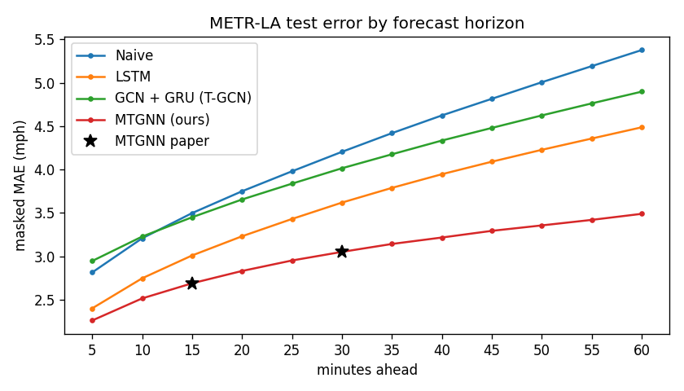
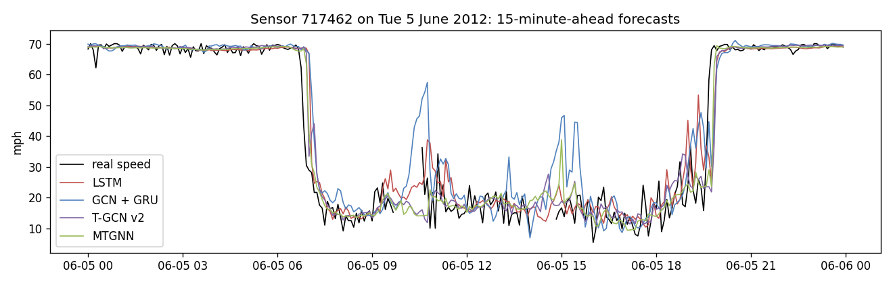
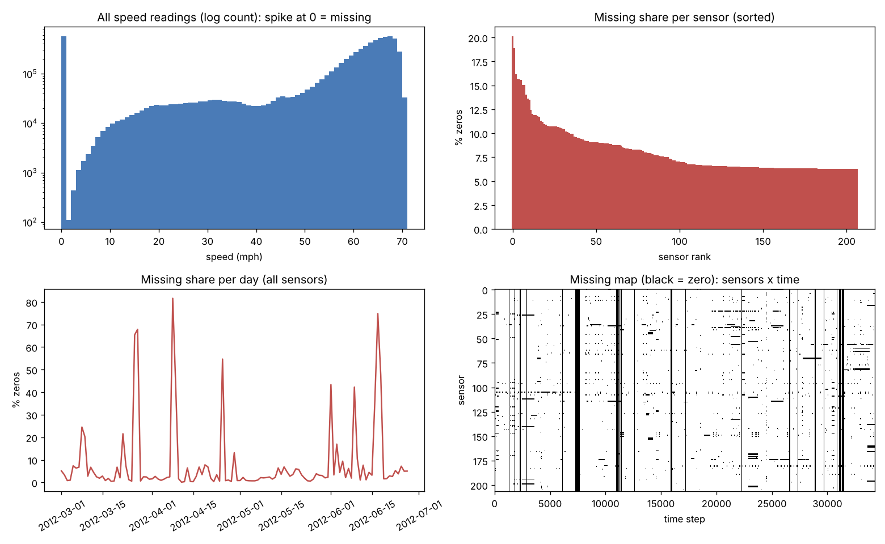
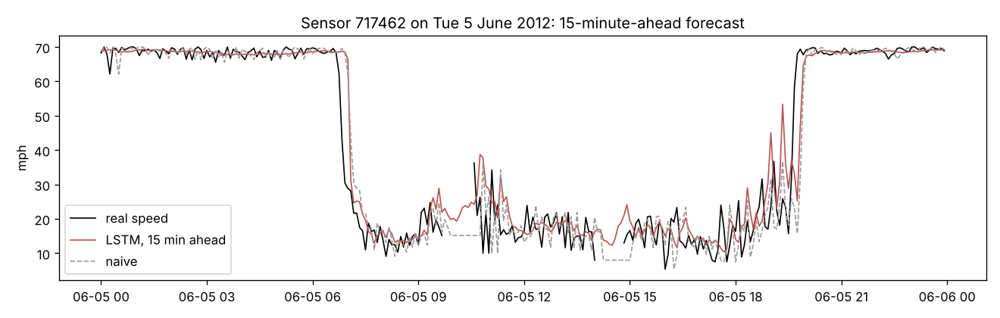

# Traffic Predictor (Student 2)

Predicts traffic speed on the METR-LA road network 5, 15 and 30 minutes ahead.
Models: an LSTM baseline that uses each sensor's own history, the brief's GCN + GRU graph model (T-GCN),
and a re-implementation of MTGNN, the reference model with the lowest error. The graph models are trained
with MTGNN's recipe. All are scored with masked MAE and RMSE and compared with DCRNN and MTGNN.

**Full report:** [`REPORT.md`](REPORT.md) (also as [`REPORT.pdf`](REPORT.pdf)): data, pipeline, models, training,
results, comparison with the papers, PEMS-BAY test, limitations and what we learned.

Everything for this part stays in this folder.

```
traffic_predictor/
  traffic_predictor.ipynb   the one notebook, run top to bottom:
                              A. get and check the data   B. prepare the data (MTGNN/DCRNN pipeline)
                              C. LSTM baseline   D. GCN + GRU (T-GCN, and v2 in D5)   E. MTGNN   F. results
                              G. PEMS-BAY: the METR-LA LSTM tested on a second dataset without retraining
  data/README.md                data sources; raw/ is downloaded by the notebook (gitignored)
  data/processed/               small derived files (per-sensor missing share)
  models/                       trained weights (<name>.pt) and resumable checkpoints (<name>_checkpoint.pt)
  results.csv                   results table written by the notebook (test split, masked MAE / RMSE)
  results_pems_bay.csv          part G's table (PEMS-BAY test split)
  figures/                      plots for the report
  requirements.txt
```

## Run

Colab: open
[the notebook in Colab](https://colab.research.google.com/github/AhmadBaabod/SIREN/blob/main/traffic_predictor/traffic_predictor.ipynb),
choose **Runtime → Change runtime type → T4 GPU**, then **Runtime → Run all**. It asks to mount Google Drive and
keeps the data, checkpoints and results in `MyDrive/SIREN/traffic_predictor/`, so after a disconnect just run all
again and training resumes. Parts D and E train 100 epochs each (MTGNN's setting), which needs the GPU.

Kaggle (when Colab has no free GPU): **Create → New Notebook → File → Import Notebook → GitHub**, pick
`AhmadBaabod/SIREN` → `traffic_predictor/traffic_predictor.ipynb`. In **Settings** choose **Accelerator → GPU T4 x2**
and turn **Internet on** (both need a phone-verified Kaggle account). Then **Save Version → Save & Run All (Commit)**:
it runs on Kaggle's servers for up to 12 hours with the browser closed, and the results are in that version's
**Output** tab under `traffic_predictor/`. If it stops early, add that output as input (**Add Input → Your Work**)
and run again: training resumes from the checkpoints.

Locally:

```bash
cd traffic_predictor
pip install -r requirements.txt
pip install --no-deps torch-geometric-temporal
jupyter notebook traffic_predictor.ipynb
```

Install `torch-geometric-temporal` with `--no-deps` as shown. A normal install tries to build `torch_sparse`, which fails on most machines, and the notebook doesn't need it.

Training saves a checkpoint every epoch, so after a Colab disconnect just run the notebook again and it resumes.
Trained weights are in `models/`, so rerunning loads them instead of training again
(delete `models/<name>_checkpoint.pt` to retrain). The LSTM took about 3.5 min per epoch on a 4-core CPU (30 epochs).

## Results so far

| Step | Result |
|---|---|
| A. Data check | 34,272 steps × 207 sensors; **8.11%** of readings are 0 (missing). 77% of these come from outages where all sensors are 0 at once. |
| B. Data pipeline | Same as MTGNN / DCRNN: zeros kept in inputs, 70/10/20 split (23,974 / 3,425 / 6,850 windows), train-only z-score, **masked** MAE/RMSE. |
| C. LSTM baseline | One LSTM shared by all sensors, time history only (51k parameters). Beats naive and the DCRNN paper's FC-LSTM; still behind the graph models. |
| D. GCN + GRU (T-GCN) | Cell from T-GCN's official code on DCRNN's road graph (14k parameters), MTGNN's recipe: Adam 1e-3, weight decay 1e-4, 100 epochs, curriculum learning. Trained on a Kaggle T4 (12 s/epoch). Weakest learned model: behind the LSTM at every horizon. **v2 (part D5)** adds DCRNN's two-way, 2-hop diffusion convolution and an encoder–decoder (373k parameters, about 3 min/epoch on a T4): 0.7–0.9 mph better than T-GCN, ahead of the LSTM, and level with the DCRNN paper (2.74 vs 2.77 at 15 min, 3.16 vs 3.15 at 30 min). |
| E. MTGNN | Rebuilt from MTGNN's official code: learned graph, dilated inception, mix-hop graph convolution. 405,452 parameters with the 3 unused convolutions, the same as the original. Trained on a Kaggle T4 (162 s/epoch, 4.5 h). **Matches the MTGNN paper and beats DCRNN** (one run; the paper averages 10). |

Test split, masked metrics, MAE / RMSE in mph (`results.csv`):

| Model | 5 min | 15 min | 30 min |
|---|---|---|---|
| FC-LSTM (DCRNN paper) | – | 3.44 / 6.30 | 3.77 / 7.23 |
| DCRNN paper | – | 2.77 / 5.38 | 3.15 / 6.45 |
| MTGNN paper (strongest reference) | – | 2.69 / 5.18 | 3.05 / 6.17 |
| Naive: repeat last reading (ours) | 2.81 / 4.63 | 3.50 / 6.42 | 4.20 / 8.05 |
| LSTM baseline (ours) | 2.40 / 4.24 | 3.01 / 5.90 | 3.62 / 7.26 |
| GCN + GRU, T-GCN (ours) | 2.95 / 5.03 | 3.45 / 6.34 | 4.02 / 7.61 |
| T-GCN v2: diffusion GCN + GRU encoder–decoder (ours) | **2.25 / 3.88** | 2.74 / 5.29 | 3.16 / 6.45 |
| **MTGNN re-implementation (ours)** | **2.26 / 3.94** | **2.69 / 5.16** | **3.05 / 6.15** |

### Second dataset: PEMS-BAY (part G)

The brief's second test set: 325 Bay Area sensors, Jan–Jun 2017, same pipeline (36,465 / 5,209 / 10,419 windows,
DCRNN's counts). The LSTM trained on METR-LA is run on it **without retraining** (masked MAE / RMSE in mph,
`results_pems_bay.csv`):

| Model | 5 min | 15 min | 30 min |
|---|---|---|---|
| FC-LSTM, trained on PEMS-BAY (DCRNN paper) | – | 2.05 / 4.19 | 2.20 / 4.55 |
| DCRNN, trained on PEMS-BAY (paper) | – | 1.38 / 2.95 | 1.74 / 3.97 |
| MTGNN, trained on PEMS-BAY (paper) | – | 1.32 / 2.79 | 1.65 / 3.74 |
| Naive: repeat last reading | 0.97 / 1.78 | 1.59 / 3.39 | 2.17 / 4.96 |
| **METR-LA LSTM, no retraining** | 1.06 / 1.91 | **1.58 / 3.32** | **2.07 / 4.59** |
| METR-LA LSTM, rescaled to PEMS-BAY statistics | 2.66 / 8.83 | 2.96 / 8.83 | 3.16 / 8.69 |

The Los Angeles model carries over a little: level with the naive forecast at 15 min, 0.10 better at 30 min, and
better than the paper's FC-LSTM trained on PEMS-BAY. Models trained on the Bay Area itself are 0.2–0.4 mph better.
Rescaling fails: congestion below about 36 mph then looks like a missing reading to the model.








