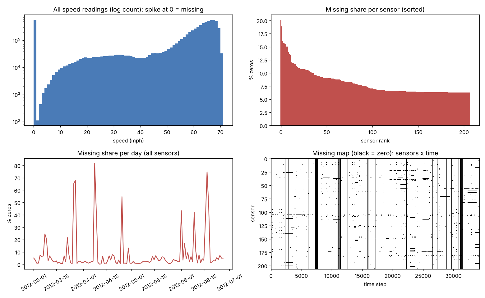
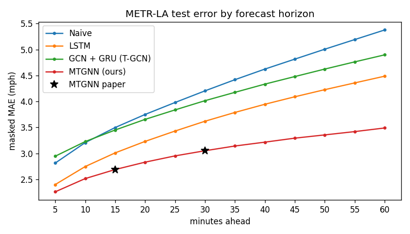
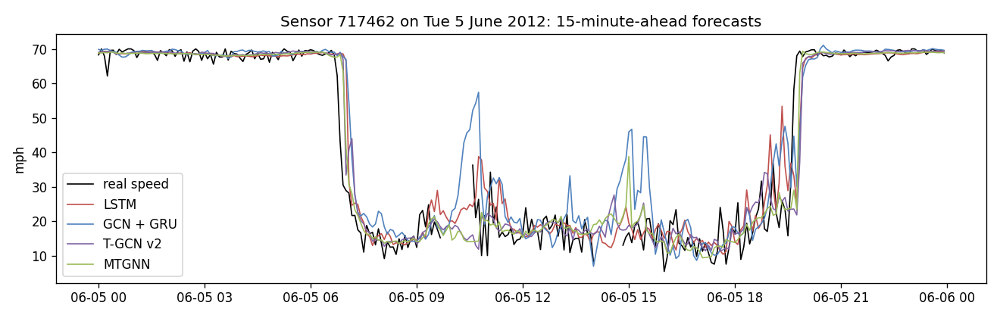

# SIREN Traffic Predictor: Report

Student 2 · CS4085 Deep Learning · Effat College of Engineering · 26 November 2026

A PDF copy of this report is in [`REPORT.pdf`](REPORT.pdf).

## Summary

Our best model, a re-implementation of MTGNN, forecasts METR-LA traffic speed with a test error of **2.69 mph at 15 minutes and 3.05 mph at 30 minutes**, matching the MTGNN paper and beating DCRNN (2.77 / 3.15).

The traffic predictor is Student 2's half of SIREN, the smart intersection. It forecasts average speed on 207 Los Angeles highway sensors 5, 15 and 30 minutes ahead, so the app can send an ambulance along the least congested route.

We trained four models on the same data pipeline and scored them the same way as the papers:

- **LSTM baseline** (time only, as the brief asks): 3.01 mph at 15 min. It beats the DCRNN paper's FC-LSTM (3.44).
- **T-GCN** (the brief's GCN + GRU graph model): 3.45 mph. It is weaker than the LSTM.
- **T-GCN v2**, the same idea rebuilt with DCRNN's diffusion convolution and an encoder-decoder: 2.74 mph, matching DCRNN.
- **MTGNN re-implementation** (the strongest published reference): 2.69 mph. It is the model the SIREN app uses.

## Data: METR-LA

METR-LA is the standard benchmark for this task: 207 loop-detector sensors on Los Angeles highways, recording average speed every 5 minutes from 1 March to 27 June 2012.

| Fact | Value |
| --- | --- |
| Time steps × sensors | 34,272 × 207 = 7,094,304 readings |
| Time grid | 5 minutes, no gaps |
| Speed range | 0 to 70 mph |
| Missing readings (stored as 0) | 575,302 (8.11%) |
| Missing from network-wide outages | 77% of the zeros, from 2,148 steps where all 207 sensors read 0 |
| Worst sensor | 718076, 20.1% missing |
| Longest run of zeros | 1,683 steps (5.8 days) |
| Mean / std, zeros excluded | 58.46 / 13.02 mph |

A zero means a missing reading, not stopped traffic: speeds between 0 and 5 mph occur only 3,378 times, against 575,302 exact zeros. Every sensor has some zeros, and the test period has more of them (12.1% of targets) than training (7.1%). This is why every score in this report ignores zero targets.

**Missing data in METR-LA.** The speed histogram spikes at exactly 0, every sensor has some zeros, and the zeros cluster in network-wide outages.

The sensor graph comes from DCRNN: a directed link from sensor *i* to *j*, weighted by road distance. It has 1,515 directed links, 7.3 per sensor on average.

## Data pipeline

We copied the pipeline of MTGNN, the strongest reference model, exactly; it uses DCRNN's data script, so our numbers are directly comparable with both papers. It reproduces DCRNN's exact sample counts.

1. **Features:** speed plus time of day (0 to 1) for each sensor and step.
2. **Windows:** the last 12 steps (1 hour) in, the next 12 steps out.
3. **Split:** windows in time order, 70% train, 10% validation, 20% test = 23,974 / 3,425 / 6,850 windows.
4. **Scaling:** only the speed input is z-scored, with the training inputs' mean and std, zeros included (54.406 / 19.494 mph). Targets stay in mph.
5. **Missing readings:** zeros stay in the inputs as 0. They are not filled in.
6. **Loss and metrics:** masked MAE as the training loss; masked MAE, RMSE and MAPE as the metrics. "Masked" means targets equal to 0 are ignored. We report the 5, 15 and 30 minute horizons (output steps 1, 3 and 6).

The mask matters. A naive forecast that repeats each sensor's last real reading scores 2.81 / 3.50 / 4.21 mph masked, but 9.55 / 10.15 / 10.76 mph unmasked, because every missing target would count as a 0 mph "error". Unmasked scores, or the plain MSE of the PyG Temporal example, cannot be compared with the papers.

The naive forecast is also our floor: any trained model must beat it.

## Models

The four models differ mainly in how much of the road network they can see, from nothing (LSTM) to a graph they learn themselves (MTGNN).

| Model | Uses the road graph | How it handles time | How it forecasts 12 steps | Parameters |
| --- | --- | --- | --- | --- |
| LSTM baseline | No: each sensor on its own | 2-layer LSTM, 64 hidden units, shared by all sensors | One linear layer from the last state | 51,468 |
| T-GCN | Yes: road distances, 1 hop | GRU whose gates are a graph convolution, 64 hidden units | One linear layer from the last state | 13,644 |
| T-GCN v2 | Yes: road distances, both directions, 2 hops | 2-layer GRU encoder with diffusion-convolution gates, 64 hidden units | 2-layer decoder, one step at a time | 373,313 |
| MTGNN re-implementation | Yes: a learned graph, top 20 links per sensor | Dilated inception convolutions (kernels 2, 3, 6, 7), 3 layers | All 12 at once from skip connections | 402,284 |

**LSTM baseline.** The brief's time-only model. One LSTM is shared by all 207 sensors: each sensor's last hour of speed and time of day goes in, and its next 12 speeds come out. It never sees the road graph.

**T-GCN** (Zhao et al., 2019). The brief's GCN + GRU model, with the cell copied from T-GCN's official PyTorch code. Each GRU gate mixes a sensor with its direct road neighbours through a normalised adjacency matrix with self-loops. Two changes keep it on the shared pipeline: 2 input features instead of 1, and masked MAE instead of MSE.

**T-GCN v2.** Our rebuild of T-GCN in the style of DCRNN (Li et al., 2018), using DCRNN's METR-LA settings. It keeps T-GCN's idea, a GRU whose gates are graph convolutions, and fixes its three limits:

- **Reach:** diffusion convolution follows the road graph both downstream and upstream, up to 2 hops (DCRNN's dual random walk).
- **Long horizons:** an encoder-decoder predicts one step at a time and feeds each prediction back in. The decoder also gets the known time of day of the step it predicts.
- **Size:** 2 layers instead of 1.

**MTGNN re-implementation** (Wu et al., 2020). Rebuilt from the official code (`net.py`, `layer.py`) with its METR-LA settings: node embeddings of size 40, 3 layers, 32 / 32 / 64 / 128 channels, dropout 0.3, mix-hop depth 2. Instead of road distances, a graph-learning layer builds its own directed graph from sensor embeddings and keeps each sensor's 20 strongest links. Each layer then looks back over time with dilated inception convolutions and mixes linked sensors in both directions with mix-hop graph convolution. Leaving out 3 residual convolutions that are never used when graph convolution is on, its 402,284 parameters equal the original's 405,452.

## Training

All models train with one shared routine: Adam, masked MAE computed in mph, gradients clipped at 5, batch size 64, keeping the weights with the lowest validation MAE. The graph models use MTGNN's own recipe, so they are trained the way the strongest reference was.

| Setting | LSTM baseline | T-GCN, T-GCN v2, MTGNN (MTGNN's recipe) |
| --- | --- | --- |
| Epochs | up to 30, early stopping after 5 epochs without improvement | 100, no early stopping |
| Learning rate / weight decay | 0.001 / none | 0.001 / 0.0001 |
| Curriculum learning | no | yes: the loss starts with the 5-minute step and adds one step every 2,500 batches (all 12 steps from about epoch 73) |
| Hardware | 4-core laptop CPU | Kaggle T4 GPU |
| Time per epoch | about 3.5 min | T-GCN 12 s, MTGNN 162 s, T-GCN v2 about 180 s |
| Best validation MAE | 3.291 (epoch 30, still improving) | T-GCN 3.713, T-GCN v2 2.838, MTGNN 2.744 |

The graph models need a GPU: on the laptop CPU they take 10 to 56 minutes per epoch. Colab had no free GPU when we trained, so they ran on Kaggle's free T4. The first Kaggle run trained T-GCN and MTGNN in about 5 hours; the second trained only T-GCN v2 (about 5 hours) and downloaded the others' finished weights.

Training saves a checkpoint after every epoch, written to a temporary file and then renamed so a disconnect cannot corrupt it. A stopped run resumes from its last finished epoch, and a finished model is loaded instead of retrained.

Curriculum learning explains an odd-looking curve: in the early epochs validation error is high (around 10 mph) because the model is trained on the first steps only, while validation scores all 12.

## Results

On the test split, the MTGNN re-implementation is best at 15 and 30 minutes and ties the MTGNN paper; T-GCN v2 is level with it at 5 minutes and matches DCRNN.

Masked MAE / RMSE in mph on the METR-LA test split (6,850 windows); lower is better. The papers report 15, 30 and 60 minutes, so their 5-minute cells are empty.

| Model | Source | 5 min | 15 min | 30 min |
| --- | --- | --- | --- | --- |
| Naive: repeat last reading | ours | 2.81 / 4.63 | 3.50 / 6.42 | 4.21 / 8.05 |
| FC-LSTM | DCRNN paper | – | 3.44 / 6.30 | 3.77 / 7.23 |
| T-GCN | ours | 2.95 / 5.03 | 3.45 / 6.34 | 4.02 / 7.61 |
| LSTM baseline | ours | 2.40 / 4.24 | 3.01 / 5.90 | 3.62 / 7.26 |
| DCRNN | DCRNN paper | – | 2.77 / 5.38 | 3.15 / 6.45 |
| T-GCN v2 | ours | **2.25 / 3.88** | 2.74 / 5.29 | 3.16 / 6.45 |
| MTGNN | MTGNN paper | – | **2.69** / 5.18 | **3.05** / 6.17 |
| MTGNN re-implementation | ours | 2.26 / 3.94 | **2.69 / 5.16** | **3.05 / 6.15** |

To three decimals, the MTGNN re-implementation scores 2.689 and 3.052 mph against the paper's 2.69 and 3.05. Its RMSE is slightly lower than the paper's at both horizons.

**Error at every step ahead.** Each model's test MAE for each of the 12 steps, 5 to 60 minutes ahead; stars mark the MTGNN paper's 15 and 30 minute results. Errors grow with the horizon, and the gap between the graph models and the rest grows with it: at 60 minutes MTGNN is at about 3.5 mph, T-GCN v2 about 3.7, the LSTM about 4.5, T-GCN about 4.9 and the naive forecast about 5.4.

**15-minute forecasts on one sensor and day.** Sensor 717462 on Tuesday 5 June 2012 (test split), the reliable sensor with the most variable speed that day. Speed falls from about 70 to under 20 mph around 7:00 and recovers around 20:00. Every model lags each sudden change by a step or two, as any 15-minute forecast must. The LSTM, T-GCN v2 and MTGNN stay close to the real speed during the slowdown, while T-GCN forecasts false recoveries, up to about 57 mph around 10:30.

## Discussion

The ranking follows how much of the road network each model can use, and how it forecasts far ahead.

- **Graph models win, once built well.** Seeing neighbouring sensors lets a model notice congestion before it arrives. T-GCN v2 and MTGNN beat the time-only LSTM by 0.27 to 0.57 mph at 15 and 30 minutes.
- **The simple T-GCN loses to the LSTM.** Its one-hop, one-direction graph cannot see congestion further away, some sensors have no links at all, and one linear layer must produce all 12 future steps. With 14k parameters it is also the smallest model. Its validation error was still falling at epoch 100.
- **v2 shows the idea works.** Adding two-way, two-hop diffusion and step-by-step decoding cuts T-GCN's error by 0.7 to 0.9 mph and brings it level with DCRNN, the model v2 copies.
- **MTGNN is best far ahead.** Its learned graph can link sensors that behave alike without being neighbours. Its lead over v2 grows with the horizon, to about 0.2 mph at 60 minutes.
- **Our LSTM beats the published FC-LSTM** (3.01 vs 3.44 at 15 minutes). Sharing one small LSTM across all sensors generalises better than one large LSTM over the whole 207-sensor vector.

Against other published METR-LA models, our MTGNN ties the best ones in this table, and T-GCN v2 sits with DCRNN and GMAN:

| Model | 15 min MAE | 30 min MAE | Source |
| --- | --- | --- | --- |
| STGCN | 2.88 | 3.47 | Graph WaveNet paper |
| DCRNN | 2.77 | 3.15 | DCRNN paper |
| GMAN | 2.77 | 3.07 | FC-GAGA paper's table |
| Graph WaveNet | 2.69 | 3.07 | Graph WaveNet paper |
| MTGNN | 2.69 | 3.05 | MTGNN paper |
| MTGNN re-implementation (ours) | 2.69 | 3.05 | this report |
| T-GCN v2 (ours) | 2.74 | 3.16 | this report |

Reruns of these models in other papers often differ by up to 0.1 mph, and the MTGNN paper averages 10 runs while ours is one. "Matches" is the fair claim, not "beats".

## Second dataset: PEMS-BAY

Run on the Bay Area with no retraining, the Los Angeles LSTM forecasts about as well as the naive forecast at 15 minutes and 0.10 mph better at 30 minutes; models trained on the Bay Area itself are 0.2 to 0.4 mph better.

PEMS-BAY is the brief's second test set: 325 Bay Area highway sensors, January to June 2017, every 5 minutes, prepared with the same pipeline (36,465 / 5,209 / 10,419 windows, DCRNN's counts). Almost nothing is missing (0.003%, against 8.11% in METR-LA). Only the LSTM can be tested this way: MTGNN, T-GCN and T-GCN v2 are tied to METR-LA's 207 sensors and road graph.

Masked MAE / RMSE in mph on the PEMS-BAY test split:

| Model | Trained on | 5 min | 15 min | 30 min |
| --- | --- | --- | --- | --- |
| Naive: repeat last reading | – | 0.97 / 1.78 | 1.59 / 3.39 | 2.17 / 4.96 |
| LSTM, as trained (ours) | METR-LA | 1.06 / 1.91 | 1.58 / 3.32 | 2.07 / 4.59 |
| LSTM, rescaled to PEMS-BAY (ours) | METR-LA | 2.66 / 8.83 | 2.96 / 8.83 | 3.16 / 8.69 |
| FC-LSTM (DCRNN paper) | PEMS-BAY | – | 2.05 / 4.19 | 2.20 / 4.55 |
| DCRNN (DCRNN paper) | PEMS-BAY | – | 1.38 / 2.95 | 1.74 / 3.97 |
| MTGNN (MTGNN paper) | PEMS-BAY | – | 1.32 / 2.79 | 1.65 / 3.74 |

- **General traffic knowledge carries over.** Without seeing a single Bay Area reading in training, the LSTM beats the paper's FC-LSTM trained on PEMS-BAY.
- **Local training still matters more.** It is only level with the naive forecast at 15 minutes and worse at 5 minutes, and models trained on the Bay Area are clearly better.
- **Rescaling fails.** With the Bay Area's own mean and spread, ordinary congestion below about 36 mph lands where METR-LA's missing readings sit (2.79 standard deviations below the mean), and the model likely treats it as missing data.
- **For Jeddah**, a model from another city is a starting point, not a finished forecaster: local data and fine-tuning are needed.

## Use in the SIREN app

The app will use the MTGNN re-implementation, the model with the lowest error at 15 and 30 minutes. The other models stay in the report as the comparison the brief asks for.

1. Student 1's emergency detector raises an alert when it finds an ambulance in a camera image or a siren in the audio.
2. MTGNN takes the last hour of readings from all 207 sensors and forecasts each sensor's speed 5 to 60 minutes ahead, in one pass.
3. Each road segment's travel time is its length divided by the forecast speed for the moment the ambulance would reach it.
4. A shortest-path search (NetworkX) picks the route with the lowest total time, and the map shows it with the forecast traffic.

METR-LA has no ambulance data, so the app must state clearly that placing the ambulance on a METR-LA sensor is a **simulated scenario**. The app itself is not built yet; it is shared work with Student 1.

## Limitations and future work

The results are strong but rest on one training run each, on one city's 2012 highway data.

**Limitations**

- **One run per model.** The MTGNN paper averages 10 runs; differences of a few hundredths of a mph between models are within run-to-run noise.
- **One dataset.** METR-LA covers Los Angeles highways only. City roads with traffic lights behave differently.
- **LSTM training was capped** at 30 epochs while validation error was still falling slightly, so its score may be a little pessimistic.
- **Small test-time randomness in MTGNN.** Its graph learner adds tiny random noise when picking each sensor's top 20 links, as in the original code, so repeated test runs can differ in the last decimal.

**Future work**

- **PEMS-BAY**, the second benchmark in the project plan: so far only the transfer test of the METR-LA LSTM. Training LSTM and MTGNN on it (about 11.5 GPU hours) would give a second full comparison with the papers.
- **Several runs per model**, to report a mean and spread like the papers.
- **Jeddah.** The models can be retrained or fine-tuned on Jeddah data: METR-LA's shared layers are reused, the per-sensor parts start fresh, then everything trains at a low learning rate. Data could come from licensed historical speeds (TomTom, HERE), a live traffic API collected over weeks, a request to the municipality, or a SUMO simulation on OpenStreetMap roads. Jeddah-specific inputs such as day of week (Friday-Saturday weekend), prayer times and Ramadan would likely matter.
- **Traffic-signal control.** With car counts per approach from Student 1's camera detector, the same forecasting pipeline could set green times 15 to 30 minutes ahead, and give green along the ambulance's route when the detector raises an alert. This must be tested in a simulator such as SUMO, against fixed-time lights.

## What we learned

The biggest lessons were about evaluation and engineering, not model size.

- **How you score decides what you can claim.** The same naive forecast scores 2.81 mph with the mask and 9.55 mph without it. Copying the reference pipeline exactly, and checking it against known facts (DCRNN's 23,974 / 3,425 / 6,850 windows, MTGNN's 405,452 parameters), is what makes our numbers comparable with the papers.
- **A simple, well-built baseline is hard to beat.** One small LSTM shared across all sensors beat the published FC-LSTM and the original T-GCN.
- **A graph helps only if the model can reach far enough.** T-GCN's one-hop, one-direction graph added little; the same idea with two-way, two-hop diffusion and a decoder matched DCRNN.
- **Long horizons separate the models.** At 5 minutes the good models are within 0.15 mph of each other; at 60 minutes the gap between MTGNN and the LSTM is about 1 mph.
- **Models are tied to their road network.** The LSTM carried over to the Bay Area only partly, and rescaling broke it, so a new city (such as Jeddah) needs local data.
- **Training infrastructure is part of the work.** Colab had no free GPU, so we moved to Kaggle; checkpoints that survive disconnects, resume automatically and download finished weights from GitHub saved hours of retraining.

## Reproducibility

Everything is in the [SIREN GitHub repository](https://github.com/AhmadBaabod/SIREN), folder `traffic_predictor/`, and runs from one notebook.

| Path | What it holds |
| --- | --- |
| `traffic_predictor.ipynb` | The whole part, with outputs: A data check, B pipeline, C LSTM, D T-GCN, D5 T-GCN v2, E MTGNN, F results, G PEMS-BAY |
| `models/` | Best weights (`<name>.pt`) and resumable checkpoints for `lstm`, `tgcn`, `tgcn_v2`, `mtgnn` |
| `results.csv` | The METR-LA results table above (`results_pems_bay.csv` holds the PEMS-BAY one) |
| `figures/` | The figures in this report, plus the missing-data overview |
| `data/` | Data sources; the raw METR-LA files are downloaded by the notebook |

To run it:

- **Colab:** open the notebook from GitHub, choose a T4 GPU, Run all. Files are kept on Google Drive, so training resumes after a disconnect.
- **Kaggle:** import the notebook from GitHub, set GPU T4 x2 and Internet on, then Save & Run All. It runs on Kaggle's servers for up to 12 hours.
- **Locally:** `pip install -r requirements.txt`, then run the notebook. Without a GPU, only the LSTM is practical to retrain.

Trained weights download automatically from GitHub, so a fresh run loads the finished models instead of retraining them, and reproduces the results table in minutes.

**Sources**

- [DCRNN: Li et al., ICLR 2018](https://arxiv.org/abs/1707.01926): METR-LA data script, DCRNN and FC-LSTM results
- [MTGNN: Wu et al., KDD 2020](https://arxiv.org/abs/2005.11650): MTGNN model, recipe and results
- [T-GCN: Zhao et al., IEEE T-ITS 2019](https://arxiv.org/abs/1811.05320): T-GCN model
- [Graph WaveNet: Wu et al., IJCAI 2019](https://arxiv.org/abs/1906.00121): Graph WaveNet and STGCN results
- [FC-GAGA: Oreshkin et al., AAAI 2021](https://arxiv.org/abs/2007.15531): GMAN results as reported in its table
